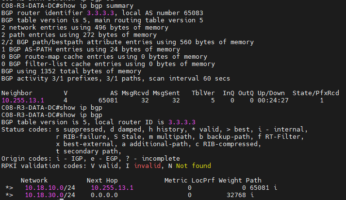
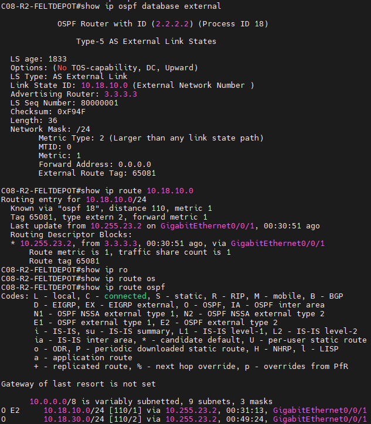
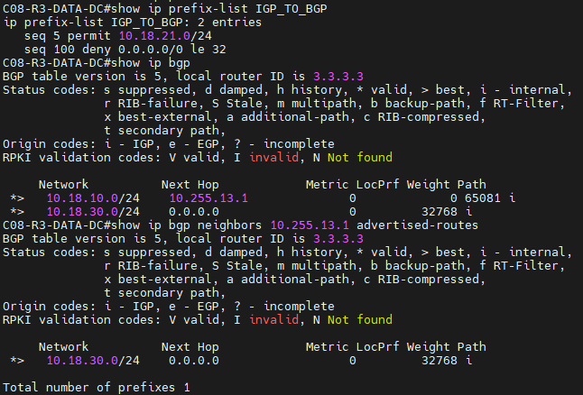
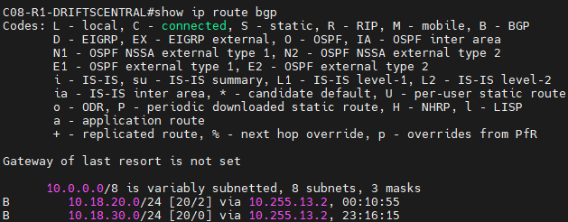

# Case 08 – MetroOps

Netværksteknologi III. Her er vores dokumentation af de 8 tickets, med skærmbilleder og forklaringer.

## INC-01 – Feltdepot og datacenter kan ikke nå hinanden på VLAN 923

**Hvad var galt:** Port Gi1/0/1 på SW2 (den der sidder til R2) stod i VLAN 924. Det VLAN findes slet ikke på switchen, så porten var inaktiv, og R2 og R3 kunne ikke se hinanden.

**Hvad vi gjorde:** Vi satte porten til VLAN 923. Vi rørte ikke ved andet.

```
interface Gi1/0/1
 no switchport access vlan 24
 switchport access vlan 923
```

**Før**


**Efter**


---

## INC-02 – OSPF mellem R2 og R3 kommer ikke op

**Hvad var galt:** R2 havde WAN23-linket i OSPF area 1, mens R3 havde det i area 0. Area-ID skal være ens på begge sider af et link, så derfor blev de to routere aldrig OSPF-naboer.

**Hvad vi gjorde:** Vi ændrede area-ID på R2 fra 1 til 0, så det matcher R3.

```
router ospf 18
 no network 10.255.23.0 0.0.0.7 area 1
 network 10.255.23.0 0.0.0.7 area 0
```

**Før**


**Efter**


---

## INC-03 – BGP mellem R3 og R1 er ikke Established

**Hvad var galt:** BGP passwordet på R1 var sat på den forkerte adresse (10.255.13.1, R1’s egen IP) i stedet for naboen R3 (10.255.13.2), og R3 havde ikke noget password sat. Sessionen kunne derfor ikke blive established.

**Hvad vi gjorde:** Vi fjernede den forkerte linje på R1, satte METROOPS på den rigtige nabo, og satte samme password på R3.

```
R1:
router bgp 65081
no neighbor 10.255.13.1 password METROOPS
neighbor 10.255.13.2 password METROOPS

R3:
router bgp 65083
neighbor 10.255.13.1 password METROOPS
```

**Resultat**



---

## INC-04 – Driftscentralens præfiks kommer ikke fra BGP ind i OSPF

**Hvad var galt:** Der var ingenting galt med redistributionen. R1’s præfiks 10.18.10.0/24 kom ikke ind i OSPF, fordi BGP mellem R1 og R3 var nede (INC-03), så R3 havde ikke ruten at redistribuere. Prefix-list og route-map på R3 er korrekte.

**Hvad vi gjorde:** Vi tjekkede prefix-list, route-map og redistribute-linjen på R3 og så, at ruten kom ind hos R2 som O E2 med tag 65081, da BGP var oppe. Vi ændrede ikke konfigurationen, fordi der ikke var noget at rette.

**Resultat**



---

## INC-05 – Feltdepotets præfiks mangler i BGP ved driftscentralen

**Hvad var galt:**

**Hvad vi gjorde:**

```
no ip prefix-list IGP_TO_BGP seq 5 permit 10.18.21.0/24
ip prefix-list IGP_TO_BGP seq 5 permit 10.18.20.0/24
```

**Før**



**Efter**




---

## INC-06 – 10.18.99.1 kan ikke nås fra de andre sites

**Hvad var galt:**

**Hvad vi gjorde:**

```
```

**Før**


**Efter**


---

## INC-07 – Feltdepotets managementtrafik bliver afvist

**Hvad var galt:**

**Hvad vi gjorde:**

```
```

**Før**


**Efter**


---

## INC-08 – Switchen mellem datacenter og driftscentral kan ikke fjernadministreres

**Hvad var galt:**

**Hvad vi gjorde:**

```
```

**Før**


**Efter**

