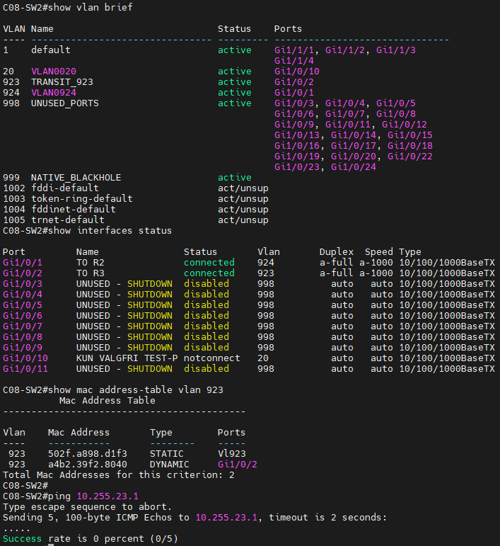
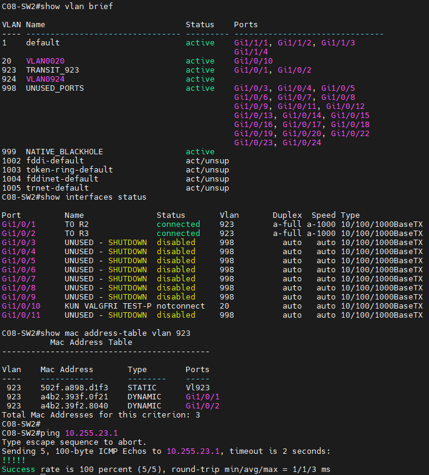
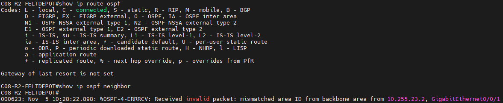
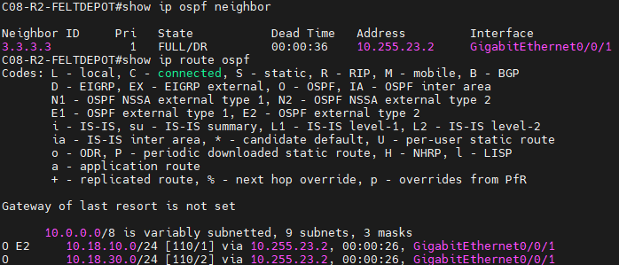
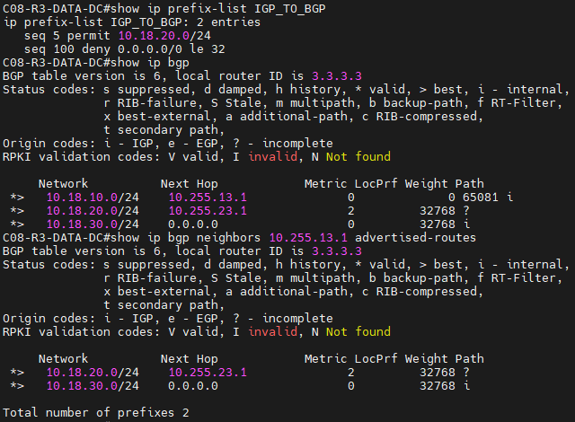
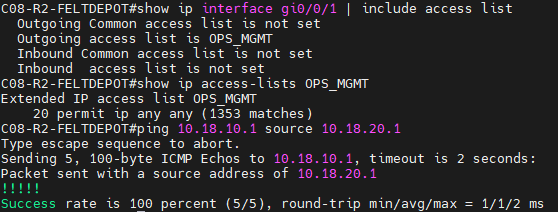
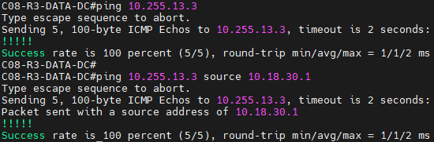

# Case 08 – MetroOps

Netværksteknologi III. Her er vores dokumentation af de 8 tickets, med skærmbilleder før og efter.

## INC-01 – Feltdepot og datacenter kan ikke nå hinanden på VLAN 923

**Hvad var galt:** Port Gi1/0/1 på SW2 (den der sidder til R2) stod i VLAN 924. Det VLAN findes slet ikke på switchen, så porten var inaktiv, og R2 og R3 kunne ikke se hinanden.

**Hvad vi gjorde:** Vi satte porten til VLAN 923, som er det rigtige. Vi rørte ikke ved andet.

```
interface Gi1/0/1
 no switchport access vlan 24
 switchport access vlan 923
```

**Før**



**Efter**



---

## INC-02 – OSPF mellem R2 og R3 kommer ikke op

**Hvad var galt:** R2 havde WAN23-linket i OSPF area 1, mens R3 havde det i area 0. Area-ID skal være ens på begge sider af et link, så de to routere blev aldrig OSPF-naboer.

**Hvad vi gjorde:** Vi ændrede area-ID’et på R2 fra 1 til 0, så det matcher R3 og resten af designet.

```
router ospf 18
 no network 10.255.23.0 0.0.0.7 area 1
 network 10.255.23.0 0.0.0.7 area 0
```

**Før**



**Efter**



---

## INC-03 – BGP mellem R3 og R1 er ikke Established

**Hvad var galt:**

**Hvad vi gjorde:**

```
```

**Før**


**Efter**


---

## INC-04 – Driftscentralens præfiks kommer ikke fra BGP ind i OSPF

**Hvad var galt:**

**Hvad vi gjorde:**

```
```

**Før**


**Efter**


---

## INC-05 – Feltdepotets præfiks mangler i BGP ved driftscentralen

**Hvad var galt:**

**Hvad vi gjorde:**

```
```

**Før**


**Efter**



---

## INC-06 – 10.18.99.1 kan ikke nås fra de andre sites

**Hvad var galt:**

**Hvad vi gjorde:**

```
```

**Før**


**Efter**


---

## INC-07 – Feltdepotets managementtrafik bliver afvist

**Hvad var galt:**

**Hvad vi gjorde:**

```
```

**Før**


**Efter**



---

## INC-08 – Switchen mellem datacenter og driftscentral kan ikke fjernadministreres

**Hvad var galt:**

**Hvad vi gjorde:**

```
```

**Før**


**Efter**

