# Case 08 – MetroOps

Netværksteknologi III. Her er vores dokumentation af de 8 tickets, med skærmbilleder og forklaringer.

## INC-01 – Feltdepot og datacenter kan ikke nå hinanden på VLAN 923

**Hypotese:** Routerne kunne ikke pinge hinanden, selv om IP adresserne var rigtige, så vi tænkte, at det var et Layer-2 problem på en af switchene.

**Hvad var galt:** Port Gi1/0/1 på SW2 (den der sidder til R2) stod i VLAN 924. Det VLAN findes slet ikke på switchen, så porten var inaktiv, og R2 og R3 kunne ikke se hinanden.

**Hvad vi gjorde:** Vi satte porten til VLAN 923. Vi rørte ikke ved andet.

```
interface Gi1/0/1
 no switchport access vlan 924
 switchport access vlan 923
```

**Før**


**Efter**


---

## INC-02 – OSPF mellem R2 og R3 kommer ikke op

**Hypotese:** Pingen virkede nu, men der var ingen OSPF naboer. Vi tænkte, at noget i OSPF konfigurationerne på linket ikke passede sammen (area, netværk eller interfaces).

**Hvad var galt:** R2 havde WAN23-linket i OSPF area 1, mens R3 havde det i area 0. Area-ID skal være ens på begge sider af et link, så derfor blev de to routere aldrig OSPF-naboer.

**Hvad vi gjorde:** Vi ændrede area-ID på R2 fra 1 til 0, så det matcher R3.

```
router ospf 18
 no network 10.255.23.0 0.0.0.7 area 1
 network 10.255.23.0 0.0.0.7 area 0
```

**Før**


**Efter**


---

## INC-03 – BGP mellem R3 og R1 er ikke Established

**Hypotese:** Transporten på VLAN 913 virkede, så vi tænkte, at fejlen var i BGP opsætningen: AS-numre eller nabo adresser.

**Hvad var galt:** BGP passwordet på R1 var sat på den forkerte adresse (10.255.13.1, R1’s egen IP) i stedet for naboen R3 (10.255.13.2), og R3 havde ikke noget password sat. Sessionen kunne derfor ikke blive established.

**Hvad vi gjorde:** Vi fjernede den forkerte linje på R1, satte METROOPS på den rigtige nabo, og satte samme password på R3.

```
R1:
router bgp 65081
no neighbor 10.255.13.1 password METROOPS
neighbor 10.255.13.2 password METROOPS

R3:
router bgp 65083
neighbor 10.255.13.1 password METROOPS
```

**Resultat**


---

## INC-04 – Driftscentralens præfiks kommer ikke fra BGP ind i OSPF

**Hypotese:** Vi tænkte, at redistributionen eller route-map’en på R3 stoppede 10.18.10.0/24. Efter at have tjekket dem viste det sig, at BGP bare havde været nede.

**Hvad var galt:** Der var ingenting galt med redistributionen. R1’s præfiks 10.18.10.0/24 kom ikke ind i OSPF, fordi BGP mellem R1 og R3 var nede (INC-03), så R3 havde ikke ruten at redistribuere. Prefix-list og route-map på R3 er korrekte.

**Hvad vi gjorde:** Vi tjekkede prefix-list, route-map og redistribute-linjen på R3 og så, at ruten kom ind hos R2 som O E2 med tag 65081, da BGP var oppe. Vi ændrede ikke konfigurationen, fordi der ikke var noget at rette.

**Resultat**


---

## INC-05 – Feltdepotets præfiks mangler i BGP ved driftscentralen

**Hypotese:** Ruten var i OSPF på R3, men ikke i BGP, så vi tænkte, at en prefix-listen filtrerede den fra.

**Hvad var galt:** Prefix-listen IGP_TO_BGP på R3 tillod 10.18.21.0/24 i stedet for feltdepotets 10.18.20.0/24. Feltdepotets præfiks blev derfor stoppet af deny og kom aldrig fra OSPF ind i BGP.

**Hvad vi gjorde:** Vi rettede seq 5 i prefix-listen til det rigtige præfiks.

```
no ip prefix-list IGP_TO_BGP seq 5 permit 10.18.21.0/24
ip prefix-list IGP_TO_BGP seq 5 permit 10.18.20.0/24
```

**Før**


**Efter**


---

## INC-06 – 10.18.99.1 kan ikke nås fra de andre sites

**Hypotese:** Beskrivelsen på Loopback99 siger “NOT ADVERTISED”, og de andre tjenester virkede, så vi tænkte, at adressen med vilje ikke skulle annonceres.

**Hvad var galt:** Der er intet galt. 10.18.99.1 er Loopback99 på R2 og er en lokal diagnoseadresse, som bevidst ikke bliver annonceret. Den står ikke i OSPF konfigurationen på R2, og prefix-listerne på R3 ville alligevel stoppe den. At de andre sites ikke kan nå den, er meningen.

**Hvad vi gjorde:** Ingenting. Vi dokumenterede med show ip route på R1, R2 og R3, at adressen kun findes lokalt på R2.

**Resultat**

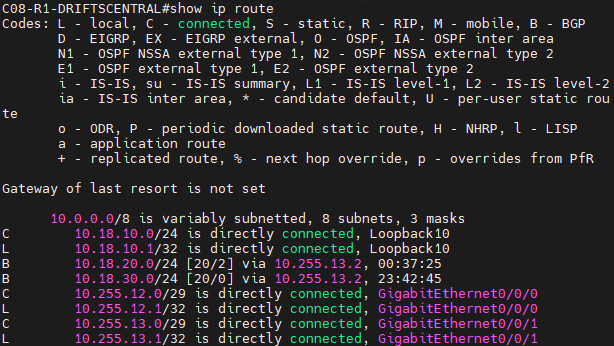
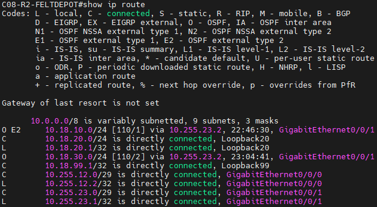
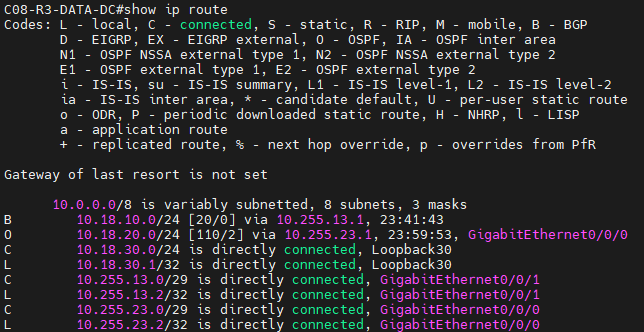

---

## INC-07 – Feltdepotets managementtrafik bliver afvist

**Hypotese:** Ruten fandtes, men trafikken blev afvist, så vi tænkte, at en ACL på en af routerne blokerede den.

**Hvad var galt:** ACL’en OPS_MGMT på R2’s Gi0/0/1 (ud) havde en deny fra feltdepotets net (10.18.20.0/24) til driftscentralens net (10.18.10.0/24). Den blokerede den trafik, routingen er bygget til, selv om ruten fandtes i tabellen. MGMT_VTY på R1 tillader samtidig hele 10.18.0.0/16, så designet forventer, at feltdepotet kan nå driftscentralen.

**Hvad vi gjorde:**  Vi fjernede deny i OPS_MGMT og beholdt permit ip any any, så ACL’en stadig er på interfacet.

```
ip access-list extended OPS_MGMT
no deny ip 10.18.20.0 0.0.0.255 10.18.10.0 0.0.0.255
```

**Før**

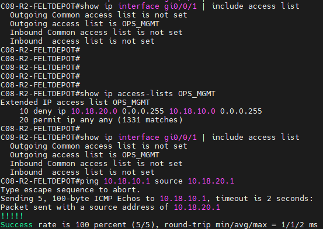

Ping virker fordi ACL'en ikke påvirker R2's egen trafik, hvis vi skulle demonstrere det rigtig ville vi have behov for en klient. (Klient ville ikke kunne snakke til MGMT trafikken før vi fjernet deny fra access listen)

**Efter**


---

## INC-08 – Switchen mellem datacenter og driftscentral kan ikke fjernadministreres

**Hypotese:** R1 og R3 kunne nå SW3, men andre net kunne ikke, så vi tænkte, at noget på SW3 var miss-konfigureret.

**Hvad var galt:** SW3 havde sin default gateway sat til 10.255.13.6, som ingen enhed bruger på VLAN 913. Switchen kunne derfor kun svare til enheder på sit eget subnet. Pings til andre sites fejlede, selv om R1 og R3 kunne nå den direkte.

**Hvad vi gjorde:** Vi rettede default gateway til R1 (10.255.13.1), som SW1 og SW2 også peger på deres .1-router.

```
no ip default-gateway 10.255.13.6
ip default-gateway 10.255.13.1
```

**Før**

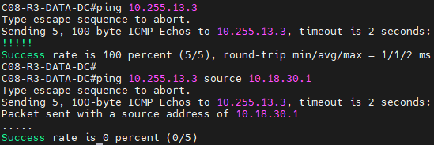
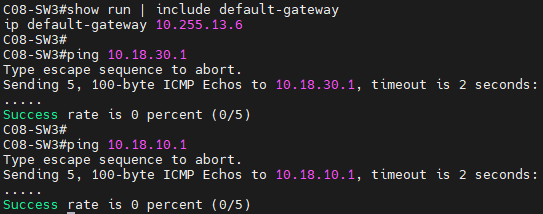

ping 10.255.13.3 source 10.18.30.1 fra R3 fejler, fordi SW3’s default gateway (10.255.13.6) ikke findes, så svaret ikke kommer tilbage. En almindelig ping fra R3 virker, fordi den er på samme subnet.

**Efter**


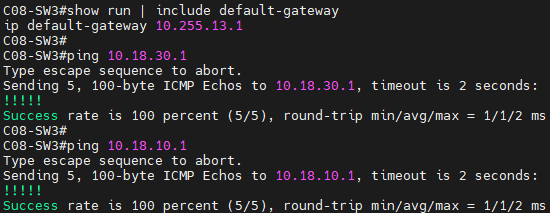
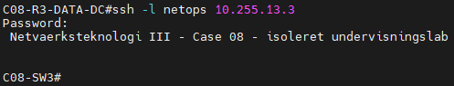

## Konklusion

Her har vi tjekket, at hele netværket virker selv efter vores ændringer på konfigurationerne.

**OSPF og BGP**

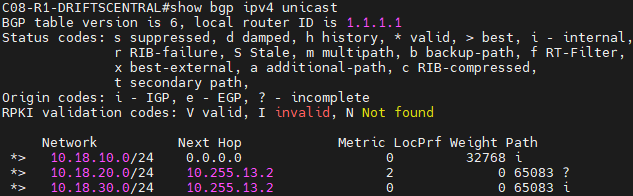
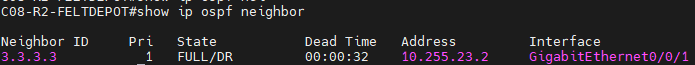
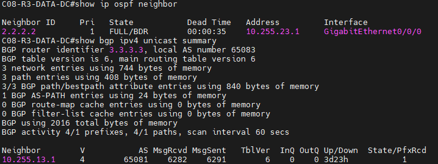

**Ruter på R1, R2 og R3**

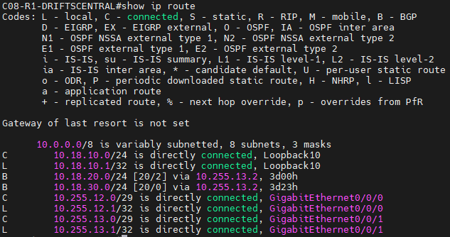
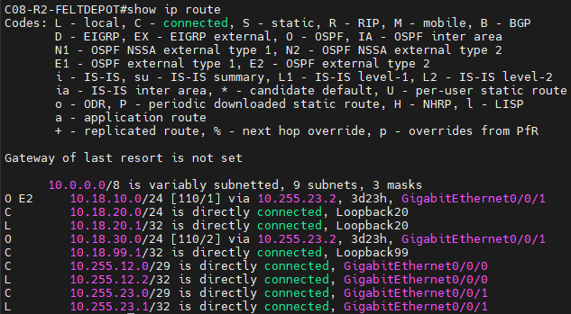
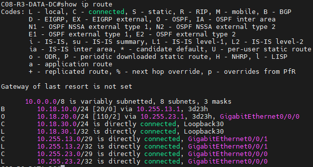
