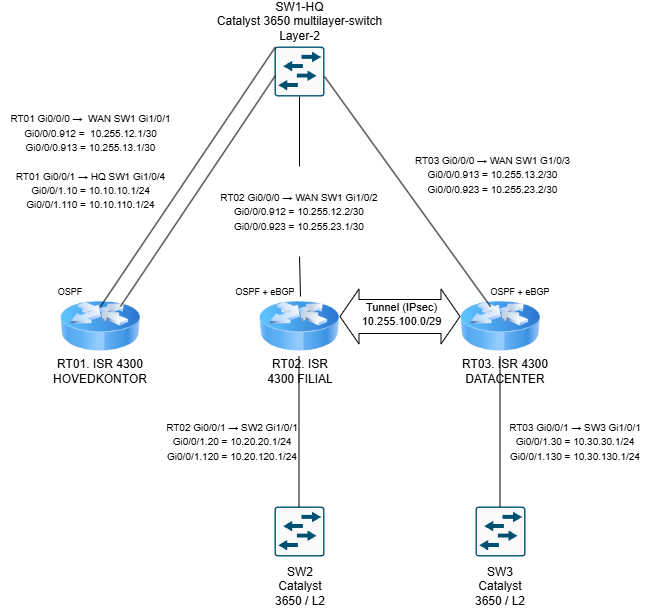

# Case opgave - Vindkraft Drift A/S

Vi er driftsteamet hos Vindkraft Drift A/S. Hovedkontoret (HQ) styrer driften, filialen indsamler data fra sensorerne, og datacentret (DC) gemmer data om driften.

## Topologi

## 1. IP-plan

### WAN

| Enhed | Interface | VLAN | IP-adresse | Netværk | Forbindelse |
| --- | --- | --- | --- | --- | --- |
| RT01 | Gi0/0/0.912 | 912 | 10.255.12.1 | 10.255.12.0/30 | RT01–RT02 |
| RT02 | Gi0/0/0.912 | 912 | 10.255.12.2 | 10.255.12.0/30 | RT02–RT01 |
| RT01 | Gi0/0/0.913 | 913 | 10.255.13.1 | 10.255.13.0/30 | RT01–RT03 |
| RT03 | Gi0/0/0.913 | 913 | 10.255.13.2 | 10.255.13.0/30 | RT03–RT01 |
| RT02 | Gi0/0/0.923 | 923 | 10.255.23.1 | 10.255.23.0/30 | RT02–RT03 (telemetri) |
| RT03 | Gi0/0/0.923 | 923 | 10.255.23.2 | 10.255.23.0/30 | RT03–RT02 (telemetri) |

### Management

| Enhed | Interface | VLAN | IP-adresse | Netværk | Gateway |
| --- | --- | --- | --- | --- | --- |
| RT01 | Gi0/0/1.10 | 10 | 10.10.10.1 | 10.10.10.0/24 | – |
| SW01 | VLAN 10 (SVI) | 10 | 10.10.10.2 | 10.10.10.0/24 | 10.10.10.1 |
| RT02 | Gi0/0/1.20 | 20 | 10.20.20.1 | 10.20.20.0/24 | – |
| SW02 | VLAN 20 (SVI) | 20 | 10.20.20.2 | 10.20.20.0/24 | 10.20.20.1 |
| RT03 | Gi0/0/1.30 | 30 | 10.30.30.1 | 10.30.30.0/24 | – |
| SW03 | VLAN 30 (SVI) | 30 | 10.30.30.2 | 10.30.30.0/24 | 10.30.30.1 |

### Tjenestenet

| Enhed | Interface | VLAN | IP-adresse | Netværk | Gateway | Kommentar |
| --- | --- | --- | --- | --- | --- | --- |
| RT01 | Gi0/0/1.110 | 110 | 10.10.110.1 | 10.10.110.0/24 | – | HQ-driftsledelse |
| HQ-admin-PC | Netkort | 110 | 10.10.110.10 | 10.10.110.0/24 | 10.10.110.1 | Test af managementadgang |
| RT02 | Gi0/0/1.120 | 120 | 10.20.120.1 | 10.20.120.0/24 | – | Sensornet |
| Sensor-test | Netkort | 120 | 10.20.120.10 | 10.20.120.0/24 | 10.20.120.1 | Kilde til telemetri |
| RT03 | Gi0/0/1.130 | 130 | 10.30.130.1 | 10.30.130.0/24 | – | DC-dataopsamling |
| DC-samler | Netkort | 130 | 10.30.130.10 | 10.30.130.0/24 | 10.30.130.1 | Destination for telemetri |

### Loopbacks og tunnel

| Enhed | Interface | IP-adresse | Maske | Bruges til |
| --- | --- | --- | --- | --- |
| RT01 | Loopback0 | 10.255.255.1 | /32 | Router-ID |
| RT02 | Loopback0 | 10.255.255.2 | /32 | Router-ID og IPsec-endpoint |
| RT03 | Loopback0 | 10.255.255.3 | /32 | Router-ID og IPsec-endpoint |
| RT03 | Loopback250 | 10.30.250.1 | /24 | Testpræfiks til V01 |
| RT02 | Tunnel0 | 10.255.100.1 | /29 | IPsec-tunnel |
| RT03 | Tunnel0 | 10.255.100.2 | /29 | IPsec-tunnel |

### Switchporte

| Switch | Port | Forbundet til | Type | VLAN |
| --- | --- | --- | --- | --- |
| SW01 | Gi1/0/1 | RT01 Gi0/0/0 | Trunk | 912, 913 |
| SW01 | Gi1/0/2 | RT02 Gi0/0/0 | Trunk | 912, 923 |
| SW01 | Gi1/0/3 | RT03 Gi0/0/0 | Trunk | 913, 923 |
| SW01 | Gi1/0/4 | RT01 Gi0/0/1 | Trunk | 10, 110 |
| SW01 | Gi1/0/5 | HQ-admin-PC | Access | 110 |
| SW02 | Gi1/0/1 | RT02 Gi0/0/1 | Trunk | 20, 120 |
| SW02 | Gi1/0/2 | Sensor-test | Access | 120 |
| SW03 | Gi1/0/1 | RT03 Gi0/0/1 | Trunk | 30, 130 |
| SW03 | Gi1/0/2 | DC-samler | Access | 130 |

### Hvorfor vi valgte det her

- WAN-linkene er /30, fordi der kun er to routere på hvert link.
- Tjenestenettene er /24. Der er plads til ca. 250 enheder, det passer til management-nettene, og så er ACL'erne nemme at læse.
- Sensor, DC-samler og HQ-admin har hvert deres VLAN, så vi kan styre trafikken mellem dem på routerne.
- Loopbacks og tunnelnet ligger i 10.255.x.x sammen med WAN-nettene. De er infrastruktur og ikke tjenestenet, og de overlapper ikke med noget.
- Tunnelen har sit eget /29-net. Vi bruger kun to adresser, men der er plads, hvis RT01 skulle tilføjes i fremtiden.

## 2. Design

### Routing

Vi kører OSPF på link 912 og 913 og eBGP på link 923. RT01 er kun transit og kører kun OSPF. RT02 (AS 65002) og RT03 (AS 65003) kører begge protokoller og er grænsen mellem dem.

eBGP har administrativ distance 20 og OSPF 110. Derfor vælger routerne altid den direkte vej over 923, når den er oppe. Når den fejler, tager OSPF over via RT01 uden at vi gør noget.

### Redistribution

Redistributionen går kun fra BGP til OSPF (og connected til OSPF for eget servicenet). Vi sender ikke OSPF ind i BGP, for så ville RT03 kunne lære HQ-nettet via BGP og vælge en dårlig vej.

- Prefix-lister og route-maps sørger for, at kun sensornettet og samlernettet bliver redistribueret.
- BGP in/out prefix-lister gør, at routerne kun sender deres egne præfikser og kun modtager de forventede.
- Tag 10 betyder lokal rute, og tag 65 betyder, at ruten kom fra BGP. Det gør det nemt at se, hvor en rute kommer fra.
- Testpræfikset 10.30.250.0/24 ligger med vilje i BGP, men bliver afvist ved redistributionen. Det bruger vi til at vise, at filteret virker.

### Telemetri, PBR og IPsec

Telemetri fra sensornettet til DC-samleren bliver krypteret i en IPsec-tunnel (VTI) mellem RT02 og RT03. Tunnelen er bygget mellem loopbackerne, så den ikke afhænger af ét bestemt link. Ruten til loopbacken går normalt over 923 og ved fejl via RT01, så tunnelen overlever fejltesten.

Vi bruger PBR til at sende trafik fra sensor til samler ind i tunnelen (og svartrafikken den anden vej). Al anden trafik bruger almindelig routing. PBR har `set interface Null0`, så telemetri bliver droppet i stedet for at gå i klartekst, hvis tunnelen går ned. Vi valgte PBR og ikke en statisk rute, fordi en statisk rute ville slå BGP og ødelægge redistributionen.

IPsec-opsætning: IKEv2 med AES-256, SHA-256, DH 14 og pre-shared key, og ESP med AES-256 og SHA-256.

### Adgangskontrol

Sensorerne må kun nå DC-samlernettet. De må ikke nå HQ, management eller transportnettet.

- `ACL-SENSOR-IN` på RT02 stopper trafikken allerede ved kilden.
- `ACL-SENSOR-GUARD` på RT01 (Gi0/0/0.912) og RT03 (Gi0/0/0.913, .923 og Tunnel0) gør, at kontrollen også gælder på reservevejen via RT01.

### Hurtig omskiftning (V07)

- BFD på link 923 (100 ms × 3). Uden BFD ville RT03 vente op til 9 sekunder på BGP, fordi switchporten stadig er oppe, når vi kun lukker RT02's subinterface.
- BGP-timers 3/9 og `fall-over bfd`.
- OSPF point-to-point med hello 1 og dead 3 på 912 og 913.

Tilbageførsel er bare `no shutdown`. BGP kommer tilbage, og tunnelen har kørt hele tiden.

## 3. Test og fremvisning

Vi kommer ind på alle enheder med SSH fra HQ-admin-PC (management-adresserne ovenfor), så vi ikke skal skifte kabler. Husk, at ping skal være tilladt i PC'ernes firewall.

Rækkefølge: forklar topologi og IP-plan, normal drift, V01, V05, V03, V06, fejltesten V02, V04, V07, og til sidst gemt konfiguration.

### V01: BGP, OSPF og redistribution

- RT02: `show ip bgp summary` (nabo 10.255.23.2 Established)
- RT01: `show ip ospf neighbor` (to naboer i Full)
- RT02: `show ip bgp 10.30.250.0` (testpræfikset findes i BGP)
- RT01: `show ip route 10.30.250.0` (findes ikke, altså ikke redistribueret)
- RT01: `show ip route 10.30.130.0` (kommer ind som `O E2`)
- RT02: `show route-map RM-BGP-TO-OSPF` og `show ip prefix-list`

Præfiks før og efter: slå redistributionen fra på RT02 og RT03 (`no redistribute connected ...` og `no redistribute bgp ...` under `router ospf 1`). Så forsvinder 10.30.130.0 fra RT01. Sæt linjerne tilbage, så kommer den igen.

### V05: Adgangskontrol

Fra sensor-test-PC:
- `ping 10.30.130.10` skal virke
- `ping 10.10.110.10` skal blive afvist
- `ping 10.10.10.1` skal blive afvist

Bagefter: `show access-lists` på RT02, og `show ip interface Gi0/0/1.120`. Vil vi vise tællerne på RT01/RT03, så pinger vi fra RT02 med `ping 10.10.110.10 source 10.20.120.1`, fordi PC'ens trafik allerede bliver stoppet på RT02.

### V03: PBR

- Ping fra sensor-PC til 10.30.130.10, og så `show route-map RM-PBR-SENSOR` på RT02 (matches stiger). På RT03: `show route-map RM-PBR-DC`.
- Kontroltrafik: `ping 10.30.30.1 source 10.20.20.1` på RT02 virker, og PBR-tælleren ændrer sig ikke.

### V06: IPsec

- RT02: `show crypto ikev2 sa` og `show crypto session detail` (READY og UP-ACTIVE)
- RT02: `show crypto ipsec sa | include #pkts` (skriv tallene ned)
- Ping fra sensor-PC til 10.30.130.10 (`ping -n 50`)
- Kør `show crypto ipsec sa | include #pkts` igen på RT02 og RT03. Encaps og decaps skal være steget.
- RT02: `show ip route 10.255.255.3` (ruten går via transportnettet og ikke via Tunnel0)

### V02: Fejltest

Et traceroute fra sensor-PC'en viser kun tunnelen, fordi den skjuler hoppene. Derfor viser vi også vejen mellem tunnelens endepunkter på RT02.

- Før: `show ip route 10.255.255.3` (B via 10.255.23.2) og `traceroute 10.255.255.3 source Loopback0` (RT02, RT03). Ping fra sensor-PC virker.
- Under: på RT02 `interface Gi0/0/0.923` og `shutdown`. Så viser ruten O via 10.255.12.1, og traceroute går RT02, RT01, RT03. Ping virker stadig, og IPsec-tællerne stiger. Vi gentager de to negative tests, og de bliver stadig afvist.
- Efter: `no shutdown`. BGP kommer tilbage (`show ip bgp summary`), og ruten er B igen.

Vi lukker kun subinterfacet Gi0/0/0.923 på RT02, ikke en switchport.

### V04: Segmentering og management

- `show vlan brief`, `show interfaces trunk` og `show ip interface brief`
- Vi viser SSH fra HQ-admin-PC til de andre enheder.

### V07: Optimering

- `show bfd neighbors`, `show ip ospf interface` og `show ip route` før, under og efter fejlen (se V02).
- Vi forklarer, hvorfor der ikke kommer loops: redistributionen går kun én vej, der er filtre, og metrikkerne er forskellige (10 og 50).

### Gemt konfiguration og tilbageførsel

- Gem med `copy running-config startup-config` på alle enheder, og vis med `show startup-config`.
- Eksempler på at tilbageføre en ændring: `no ip access-group ACL-SENSOR-IN in` på Gi0/0/1.120, eller `no ip policy route-map RM-PBR-SENSOR` på samme interface.
- Ved backup bruger vi `copy flash:RT02-basis.cfg running-config`. Det lægger konfigurationen oven på den kørende. Til en fuld genskabelse bruger vi `configure replace flash:RT02-basis.cfg`.

## 4. Spørgsmål vi kan få

- Hvorfor kører RT01 kun OSPF? Den er kun transit og reservevej, så der er ikke brug for BGP.
- Hvorfor BGP på 923 og OSPF på 912/913? BGP har lavere distance og vinder, når 923 er oppe. Når den fejler, tager OSPF over.
- Hvorfor kun redistribution fra BGP til OSPF? Ellers kunne HQ-nettet komme ind i BGP og give dårlige ruter og feedback.
- Hvad er testpræfikset til? Det viser, at filteret virker. Det er i BGP, men kommer ikke ind i OSPF.
- Hvorfor BFD? Så RT03 også opdager fejlen med det samme og ikke venter på BGP-timeren.
- Hvorfor ACL flere steder? Så kontrollen også virker på reservevejen via RT01.
- Hvorfor tunnel (VTI) og ikke crypto map? Tunnelen kører mellem loopbacks og er uafhængig af linket. En crypto map skulle sidde på hvert WAN-link.
- Hvad sker der, hvis tunnelen går ned? PBR sender til Null0, så der går ikke noget i klartekst.
- Hvordan ved vi, at trafikken er krypteret? Encaps og decaps stiger i `show crypto ipsec sa`, når vi sender trafik.

## 5. Begrænsninger

- PBR kan kun se, om vores eget link er oppe, og ikke om naboen er død. IP SLA/track (V08) kunne løse det, men det har vi ikke lavet.
- Tags er kun mærkater. Det er filtrene og den ene retning, der forhindrer feedback.
- Pre-shared key står i klartekst i konfigurationen. Det er okay i et lab.